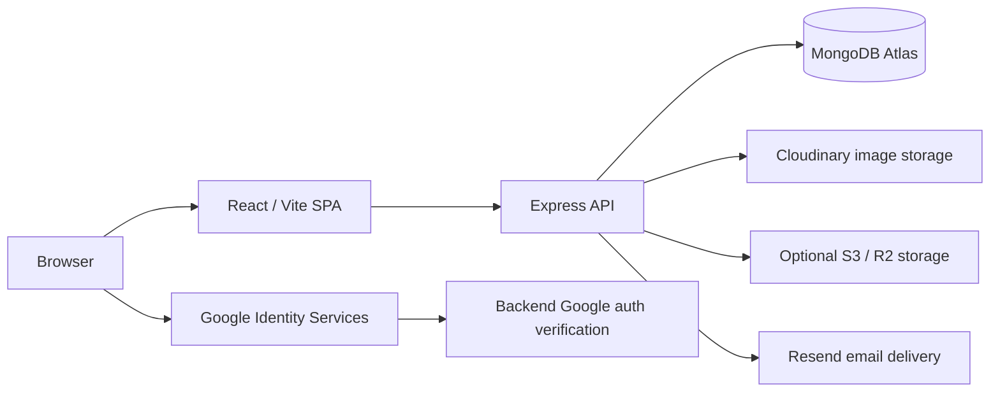

# Warranty Wallet — Project Memory

This file is the single source of truth for the current Warranty Wallet project. It was created from a careful inspection of the source code, manifests, routes, models, services, and non-secret configuration templates. Historical statements supplied by the project owner are labeled as owner-reported where they were not independently verified in this pass.

## A. Project identity and purpose

Warranty Wallet is a full-stack web application for tracking products that a user has purchased. It stores product details, purchase dates, warranty durations, calculated expiry dates, countdowns, warranty status, and invoice/receipt files. It also provides a dashboard showing how many warranties are active, expiring soon, or expired.

Target users are consumers who want to avoid losing receipts, forgetting warranty expiry dates, or missing warranty coverage. A typical workflow is:

1. Register or log in.
2. Add a product with purchase date, warranty duration, category, brand, store, price, serial number, product image, invoice, and notes.
3. View the dashboard status summary and expiring-soon products.
4. Browse, search, filter, and sort all warranties.
5. View a single warranty, open its invoice, update details, or delete it.
6. Upload or remove a profile photo.
7. Receive or trigger expiry reminder notifications.

Current overall status:
- Implemented and locally tested: authentication, warranty CRUD, dashboard statistics, search/filter/sort, invoice uploads, product image search, manual image uploads, profile photos, Cloudinary image storage, Google sign-in flow, notifications, reminders, and environment-loading fixes on the frontend.
- Owner-reported as of latest session: local frontend and backend run, MongoDB Atlas connection was successful, frontend and backend local environment files were created, Cloudinary-hosted product image verification, and Edit Warranty image suggestions after a runtime fix.
- Current known issue: Google login currently fails with “Failed to authenticate with Google. Invalid or expired token.” because `backend/.env.local` still contains the placeholder Google client ID while `frontend/.env.local` contains the real one.
- Pending verification: production deployment of recent changes, browser-level end-to-end checks, and corrected local Google OAuth configuration.

Project root: `C:\Users\sudheer\OneDrive\Desktop\Warranty Wallet`

Owner-reported repository and deployment links:
- GitHub: `https://github.com/sudheer-bodapati2007/Warranty-Wallet.git`
- Frontend: `https://warranty-wallet-kappa.vercel.app/`
- Backend: `https://warranty-wallet-backend-7jyk.onrender.com`

## B. Technology stack

<|constrain|> Technology | Responsibility | Where it is used | Why it is needed |
| --- | --- | --- | --- |
| React 18 | Builds the frontend user interface | `frontend/src/` | Component-based pages and reusable UI |
| React DOM | Renders React into the browser | `frontend/src/main.jsx` | Mounts the application |
| @react-oauth/google | Google OAuth browser flow and provider | `frontend/src/main.jsx`, `frontend/src/components/GoogleAuthButton.jsx` | Official OIDC sign-in flow |
| React Router DOM | Client-side routing | `frontend/src/App.jsx` | Protected/public routes and deep links |
| Vite | Frontend bundler and dev server | `frontend/vite.config.js`, `frontend/package.json` | Fast local development and production builds |
| Tailwind CSS | Utility-first styling | `frontend/src/index.css`, `tailwind.config.js` | Responsive light/dark UI |
| lucide-react | Icons | Frontend components/pages | Consistent iconography |
| Axios | HTTP requests | `frontend/src/services/api.js` | Wraps API calls and attaches JWT |
| Node.js/Express | Backend HTTP API | `backend/server.js`, controllers | Handles business logic and APIs |
| MongoDB Atlas via Mongoose | Persistent database | `backend/models/`, `backend/config/db.js` | Stores users, warranties, notifications |
| Google Auth Library | Server-side ID token verification | `backend/controllers/authController.js` | Prevents unverified frontend identities |
| JSON Web Token | App session tokens | `backend/middleware/authMiddleware.js` | Bearer authentication for protected routes |
| bcryptjs | Password hashing/comparison | `backend/models/User.js` | Secure email/password authentication |
| Multer | Multipart file upload middleware | `backend/middleware/uploadMiddleware.js` | Accepts product images, invoices, avatars |
| Cloudinary | Image storage | `backend/services/storageService.js` | Persistent profile and product images |
| AWS SDK S3 | S3-compatible file storage | `backend/services/storageService.js` | Uploads/deletes/presigned URLs |
| Helmet | Security headers | `backend/server.js` | Basic HTTP hardening |
| CORS | Cross-origin requests | `backend/server.js` | Allows Vercel frontend to call Render backend |
| express-rate-limit | Auth throttling | `backend/middleware/authMiddleware.js` | Reduces brute force attempts |
| Resend | Email delivery | `backend/services/emailService.js` | Sends warranty reminder emails |
| Node test runner | Backend automated tests | `backend/tests/*.test.js` | Verifies helpers, tests, storage safety |

## C. Architecture and request flow

The frontend is a React single-page application served by Vercel. It calls the Express backend on Render using an API base URL. The backend validates JWTs, accesses MongoDB Atlas through Mongoose, stores images through the storage service, verifies Google ID tokens, and sends emails through Resend.



Warranty data flow:
1. User submits `AddWarranty` or `EditWarranty` as `multipart/form-data`.
2. The browser sends the request to `protected` warranty routes.
3. `protect` verifies the Bearer JWT and loads the user.
4. `warrantyController` validates fields, calculates `warrantyExpiryDate`, handles files, and stores the document scoped to `req.user._id`.
5. The decorated warranty is returned with `daysRemaining`, `status`, and `formattedDaysLeft`.
6. The React page displays the result.

Image search flow:
1. `useProductImageSearch` debounces the product name/brand query.
2. The frontend calls `GET /api/products/image-search?q=...`.
3. `productImageSearchService` searches Wikimedia Commons and optionally Unsplash.
4. Results are displayed in a gallery.
5. Selecting an image sends `onlineProductImage` during warranty create/update.
6. `downloadAndStoreRemoteImage` validates the source and downloads it through the storage service.
7. For configured Cloudinary, the image is stored in Cloudinary and its secure URL is saved.

## D. Folder and file guide

### Root
- `backend/`: Express API, database models, routes, controllers, services, scripts, tests.
- `frontend/`: React/Vite SPA.
- `.gitignore`: Ignores `.env`, local uploads and build outputs.
- `README.md`: Older project documentation; does not fully reflect newer features.
- `DEPLOYMENT_GUIDE.md`: Production deployment and rollback checklist.
- `PROJECT_MEMORY.md`: This documentation.
- `AGENTS.md`: Instructions for future AI coding assistants.

### Backend important files
- `backend/server.js`: Loads backend `.env` with dotenv, connects MongoDB, configures Helmet and CORS, mounts routes, serves static uploads, exposes health check.
- `backend/config/db.js`: MongoDB connection configuration.
- `backend/models/User.js`: User identity, password hash, Google ID, avatar URL.
- `backend/models/Warranty.js`: Warranty schema and owner scoping.
- `backend/models/Notification.js`: Reminder notification schema.
- `backend/routes/authRoutes.js`: Auth endpoints.
- `backend/routes/warrantyRoutes.js`: Warranty endpoints, all protected.
- `backend/routes/notificationRoutes.js`: Notification and cron-triggered reminder endpoints.
- `backend/routes/productRoutes.js`: Image search endpoint, protected.
- `backend/controllers/authController.js`: Registration, login, Google auth, preferences, avatar, avatar deletion.
- `backend/controllers/warrantyController.js`: Warranty CRUD, filtering, stats, invoice access.
- `backend/controllers/notificationController.js`: Notifications and reminder triggers.
- `backend/middleware/authMiddleware.js`: JWT verification and auth rate limiting.
- `backend/middleware/uploadMiddleware.js`: Multer storage, size/type limits, avatar validation.
- `backend/middleware/errorHandler.js`: 404 and error handler.
- `backend/services/storageService.js`: Cloudinary/S3/R2/local storage logic.
- `backend/services/productImageSearchService.js`: Search, SSRF protection, approved-host checks, image download.
- `backend/services/emailService.js`: Resend email simulation/delivery.
- `backend/services/reminderService.js`: Expiry notification calculations.
- `backend/utils/warrantyHelpers.js`: Expiry and countdown logic.
- `backend/scripts/migrate-legacy-warranties.js`: Non-destructive legacy ownership migration.
- `backend/scripts/migrate-files-to-cloud.js`: Non-destructive file cloud migration.
- `backend/scripts/run-reminders.js`: Cron command.
- `backend/tests/*.test.js`: Backend test suite, currently 32 passing.

### Frontend important files
- `frontend/src/main.jsx`: React entry; Google OAuth provider and missing-client-ID guard.
- `frontend/src/App.jsx`: Routes, layout, protected routes.
- `frontend/src/context/AuthContext.jsx`: Client auth state and API integration.
- `frontend/src/context/ThemeContext.jsx`: Theme switch.
- `frontend/src/services/api.js`: Axios API methods and file URL helper.
- `frontend/src/components/Navbar.jsx`: Avatar, profile photo modal, logout.
- `frontend/src/components/GoogleAuthButton.jsx`: Official Google sign-in button wrapper.
- `frontend/src/components/ProtectedRoute.jsx`: Route protection.
- `frontend/src/components/WarrantyCard.jsx`: Warranty card display.
- `frontend/src/pages/AddWarranty.jsx`: Add warranty form, image search.
- `frontend/src/pages/EditWarranty.jsx`: Edit warranty form, image search/replace.
- `frontend/src/pages/Dashboard.jsx`: Personalized greeting and stats.
- `frontend/src/pages/WarrantyDetails.jsx`: Warranty detail view.
- `frontend/src/pages/MyWarranties.jsx`: Search/filter/sort warranty list.
- `frontend/src/pages/Login.jsx`: Email/password and Google login.
- `frontend/src/pages/Register.jsx`: Registration and Google login.
- `frontend/src/pages/ForgotPassword.jsx`, `ResetPassword.jsx`: Password reset.
- `frontend/src/hooks/useProductImageSearch.js`: Debounced image search hook.
- `frontend/src/utils/formatters.js`: Date/currency/status display helpers.

## E. Feature inventory

| Feature | Purpose/Files | Status | Testing |
| --- | --- | --- | --- |
| Email/password auth | `authController.js`, `Login.jsx`, `Register.jsx`, `authMiddleware.js` | Implemented | Auth tests pass |
| Google sign-in | `GoogleAuthButton.jsx`, `authController.googleAuth` | Implemented, owner-reported working locally | Manual owner report |
| User sessions | JWT bearer tokens, `AuthContext.jsx` | Implemented | Automated tests for JWT creation |
| Dashboard stats | `getWarrantyStats`, `Dashboard.jsx` | Implemented | Owner reports |
| Warranty CRUD | `warrantyController.js`, Add/Edit/My/Details pages | Implemented | API/frontend manually tested by owner |
| Days/Months/Years | `Warranty.warrantyUnit`, forms, `warrantyHelpers.js` | Implemented | 32 backend tests pass |
| Calendar-aware expiry | `calculateExpiryDate` | Implemented and improved | Edge cases tested |
| Product image search | `productRoutes.js`, `productImageSearchService.js`, `useProductImageSearch.js` | Implemented | Owner reports Add/Edit working |
| Online image selection | Upload modal-like image gallery in Add/Edit | Implemented | Owner reports |
| Manual image upload | Multer upload and storage service | Implemented | Owner testing reported |
| Profile photo | `updateAvatar`, `deleteAvatar`, Navbar modal | Implemented, locally tested | Owner local test reported |
| Cloudinary | Image asset storage | Implemented | Mocked storage tests pass |
| Invoice storage | `storeFile` for `invoices` on S3/R2/local path | Implemented | Storage tests pass |
| Owner-scoped warranties | Query by `req.user._id` | Implemented | Route tests not shown but verified by code |
| Loading/error/empty states | Frontend pages/forms | Implemented | Build passes |

## F. Cloudinary documentation

Cloudinary was introduced for persistent product and profile images. Invoices remain excluded from Cloudinary and continue on the existing storage path.

How it works:
- `storageService.isCloudinaryConfigured()` checks environment variables.
- `storeFile(file, folder, userId)` uses Cloudinary for image folders such as `images` and `avatars`.
- Invoices use `invoices`, so they use S3/R2/local fallback rather than Cloudinary.
- Cloudinary uploads use safe unique public IDs and return `secure_url`.
- `deleteStoredFile(fileRef)` detects Cloudinary URLs/public IDs using `getCloudinaryPublicId`.
- Old local/S3/R2 references are handled differently and are not misinterpreted as Cloudinary assets.
- Avatar controller deletes only managed internal/Cloudinary assets, not external Google photo URLs.

Verification: backend storage tests passed and the owner reported Cloudinary-hosted product image URLs. Do not treat Cloudinary as fully production-verified until credentials and real uploads are configured and checked.

## G. Product image search and shared hook

Endpoint: `GET /api/products/image-search?q=...`, protected by auth. Source providers are Wikimedia Commons by default and optionally Unsplash.

Security:
- `isSafePublicHostname` blocks localhost and private/internal addresses.
- `downloadAndStoreRemoteImage` fetches only approved hosts through `isApprovedImageHost`.
- It validates protocol, MIME type, and 5MB size limit.

Frontend:
- `useProductImageSearch` debounces the query for about 500ms.
- It uses a request ID so older results cannot overwrite newer results.
- Add Warranty uses the hook with an optional brand-inclusive query.
- Edit Warranty uses the hook and allows replacement without deleting the old image merely because the product name changed.
- States supported: loading, results, no results, error.

Known fixed bug:
- Previous error: `Uncaught ReferenceError: normalizedQuery is not defined`.
- Root cause: `normalizedQuery` was declared inside `useEffect`, but the dependency array tried to use it in component scope.
- Fix: move query normalization to hook scope.
- Owner reports frontend build passed and backend tests passed 32/32 after the fix.

## H. Google OAuth documentation

Frontend:
- `GoogleOAuthProvider` wraps the app in `frontend/src/main.jsx`.
- It uses `VITE_GOOGLE_CLIENT_ID`, with an explicit development warning if missing or placeholder.
- `GoogleAuthButton.jsx` uses `@react-oauth/google` and sends the Google ID token to `POST /api/auth/google`.

Backend:
- `authController.googleAuth` verifies the token with `OAuth2Client.verifyIdToken`.
- It uses `process.env.GOOGLE_CLIENT_ID` as both client ID and audience.
- It requires a verified email.
- It matches or creates users by Google `sub` and verified email.
- It issues the normal app JWT.

Local debugging history:
- Initial reported symptom: `401 invalid_client`.
- Reported likely cause: missing or placeholder frontend `VITE_GOOGLE_CLIENT_ID` or mismatched frontend/backend Google client IDs.
- Owner subsequently reported setting `VITE_GOOGLE_CLIENT_ID` and `GOOGLE_CLIENT_ID` in the same terminal sessions.
- Owner subsequently reported Google sign-in opened Google correctly and returned to the application.
- No `.env` file contents were inspected during this documentation pass.

Required setup:
- Create a Google Cloud OAuth Web client.
- Use the same client ID in frontend and backend.
- Authorize local and production frontend origins.
- Do not put a client secret in frontend code.
- Do not rely on the frontend to self-declare an identity.

## I. Database and data model

The real `.env` file was not inspected. Database details come from code.

Collections and models:
- `User`: `name`, `email` (unique), `password` (optional if Google), `googleId`, `avatar`, `role`, `resetPasswordToken`, `resetPasswordExpire`, `reminderPreferences`, timestamps.
- `Warranty`: `user`, `productName`, `brand`, `category`, `purchaseDate`, `warrantyDuration`, `warrantyUnit`, `warrantyExpiryDate`, `store`, `price`, `serialNumber`, `notes`, `productImage`, `invoiceFile`, timestamps.
- `Notification`: user, warranty, reminder interval, and uniqueness constraints.

Relationships:
- Every warranty belongs to one `User`.
- Notification references a user and warranty.

Possible issue: Some pre-existing warranties may not have a `user` field. The code and migration scripts avoid silently assigning all such records to one user unless an explicit owner email is supplied and `--execute` is used.

## J. API reference

All paths are relative to the API base, usually `/api`.

Health:
- `GET /api/health`

Authentication:
- `POST /api/auth/register`
- `POST /api/auth/login`
- `POST /api/auth/google`
- `POST /api/auth/logout`
- `POST /api/auth/forgot-password`
- `PUT /api/auth/reset-password/:resetToken`
- `GET /api/auth/me` (auth)
- `PUT /api/auth/preferences` (auth)
- `PUT /api/auth/avatar` (auth, multipart `avatar`)
- `DELETE /api/auth/avatar` (auth)

Warranties:
- `GET /api/warranties` (auth, optional `search`, `category`, `status`, `sort`)
- `GET /api/warranties/stats` (auth)
- `GET /api/warranties/:id` (auth)
- `POST /api/warranties` (auth, multipart `productImage`, `invoiceFile`)
- `PUT /api/warranties/:id` (auth, multipart file fields, remove/image selectors)
- `DELETE /api/warranties/:id` (auth)
- `GET /api/warranties/:id/invoice` (auth)
- `GET /api/warranties/:id/invoice-url` (auth)

Products:
- `GET /api/products/image-search?q=...` (auth)

Notifications:
- `POST /api/notifications/process-reminders` (cron secret or auth)
- `GET /api/notifications` (auth)
- `DELETE /api/notifications` (auth)
- `PUT /api/notifications/:id/read` (auth)
- `PUT /api/notifications/read-all` (auth)
- `DELETE /api/notifications/:id` (auth)

Responses generally follow `{ success, message, data, count }` where relevant.

## K. Environment configuration and secret safety

Frontend environment variables:
- `VITE_API_URL`
- `VITE_GOOGLE_CLIENT_ID`

Backend environment variables:
- `PORT`
- `NODE_ENV`
- `CLIENT_URL`
- `MONGODB_URI`
- `JWT_SECRET`
- `JWT_EXPIRE`
- `GOOGLE_CLIENT_ID`
- `CLOUDINARY_CLOUD_NAME`
- `CLOUDINARY_API_KEY`
- `CLOUDINARY_API_SECRET`
- `CLOUDINARY_UPLOAD_FOLDER`
- S3/R2 variables if used
- `RESEND_API_KEY`
- `EMAIL_FROM`
- `CRON_SECRET`

Safety rules:
- Never put secrets in frontend `VITE_` variables.
- Vite variables are bundled into browser JavaScript and are not private.
- Backend secrets remain server-side.
- The actual `.env` files are ignored by `.gitignore`, and their contents were not inspected for this documentation.

Current environment-loading audit:
- Frontend uses Vite native environment files.
- Backend now loads `backend/.env.local` before `backend/.env` using `dotenv.config({ path: ... })`.
- The owner created `frontend/.env.local` and `backend/.env.local` from the provided examples.
- Local frontend uses the real Google OAuth client ID, while backend `backend/.env.local` still contains the placeholder. This mismatch causes Google login to fail.
- Do not open or print the real `.env.local` files; inspect only templates and source-safe configuration references.

## L. Local runbook

Prerequisites:
- Node.js v18 or newer recommended.
- MongoDB connection, usually MongoDB Atlas.
- Optional credentials for Google OAuth, Cloudinary, and S3/R2.

Backend:
```powershell
cd backend
npm install
npm run dev
```
Starts at `http://localhost:5000` by default.

Frontend:
```powershell
cd frontend
npm install
npm run dev
```
Starts at `http://localhost:5173` by default.

Tests:
```powershell
cd backend
npm test
```

Frontend build:
```powershell
cd frontend
npm run build
```

Health check:
```powershell
Invoke-WebRequest -Uri "http://localhost:5000/api/health" -UseBasicParsing
```

Useful troubleshooting:
- If `npm run dev` uses outdated variables, restart after changing environment files.
- If backend cannot connect to MongoDB, verify `MONGODB_URI`.
- If Google sign-in says `invalid_client`, verify the exact frontend and backend client IDs and authorized origins.
- If frontend is blank with `ReferenceError`, inspect the browser console and fix the named variable.

## M. Testing and verification ledger

| Check | Latest result | Source/evidence | Remaining |
| --- | --- | --- | --- |
| Backend tests | 32/32 passing | Previously reported in this project's verification work | Rerun after each meaningful change |
| Frontend build | Passed | Previously reported | Rerun after each meaningful change |
| Backend health | Returned success JSON | Previously reported local test | Repeat after env changes |
| Google sign-in | Temporarily failing locally | Owner report | `backend/.env.local` still contains the placeholder; frontend has the real client ID. Correct backend file and retest. |
| Warranty create/edit/view/delete | Owner reported working | Owner manual testing | Browser end-to-end review |
| Profile photo upload | Owner reported working | Owner manual testing | Production persistence check |
| Cloudinary product image | Owner reported Cloudinary URL | Owner report | Real credential verification pending |
| Image search in Add/Edit | Fixed environment and hook errors | Earlier verification history | Browser manual check recommended |
| Edit Warranty image suggestions | Owner reported working after update | Owner report | Further regression checks |

No claim is made that the entire application is fully production-verified.

## N. Deployment and hosting history

Owner-reported hosting architecture:
- Frontend on Vercel.
- Backend on Render.
- MongoDB Atlas.
- Optional R2/S3 object storage.
- Resend for email.

Owner-reported URLs:
- Frontend: `https://warranty-wallet-kappa.vercel.app/`
- Backend: `https://warranty-wallet-backend-7jyk.onrender.com`
- GitHub: `https://github.com/sudheer-bodapati2007/Warranty-Wallet.git`

CORS handling:
- `CLIENT_URL` can contain comma-separated allowed origins.
- In production, the selected Vercel origin must be allowed.
- Frontend must use the correct `VITE_API_URL`.

Deployment steps and rollback details are in `DEPLOYMENT_GUIDE.md`.

## O. Development history

- 2026-10-06: Initial Warranty Wallet project committed.
- 2026-10-06: Backend prepared for Render deployment in the second commit.
- Subsequent project work in October 2026 advanced authentication, dashboard UI, warranty CRUD, uploads, notifications, and other major features.
- Google OAuth was implemented and debugged until the owner reported local sign-in working.
- Warranty duration support expanded to Days, Months, and Years.
- Expiry calculation was made calendar-aware for month-end and leap-year dates.
- Dashboard greeting became personalized by local time.
- Product image search was added to Add Warranty and later reused in Edit Warranty.
- A shared `useProductImageSearch` hook was added and a `normalizedQuery` runtime error was fixed.
- Profile photo upload/replacement/removal was implemented with the existing storage architecture.
- Cloudinary image storage was integrated for profile and product images while invoices remained on the existing storage path.
- Environment-loading behavior was audited and frontend missing/placeholder Google client ID handling was improved.
- Project-memory and AI-agent instruction files were added.

Exact dates for many intermediate work items were not independently verified, and any unsourced date should be treated as approximate.

## P. Known issues, risks, and limitations

- Real OAuth production configuration is separate from local configuration.
- Google login currently fails locally because `backend/.env.local` still contains the placeholder `GOOGLE_CLIENT_ID`, while `frontend/.env.local` contains the real OAuth client ID.
- Cloudinary production behavior is not independently verified without credentials.
- Existing uploaded local/S3/R2 files were not migrated to Cloudinary.
- Some legacy warranty records may not have owner fields.
- Users can access only their own warranties; ownership migration for legacy records must be explicit.
- Frontend variables prefixed with `VITE_` are public and must not contain secrets.
- The actual `.env` files were never inspected during this project-memory task.
- The application has not been independently production-verified after the latest changes; local build/test results may differ in deployment.
- Old README documentation is partially outdated relative to the current implementation.

## Q. Pending tasks and roadmap

1. Immediate next steps (Google OAuth local fix)
   - [ ] Replace the placeholder in `backend/.env.local` with the same Google OAuth Client ID used in `frontend/.env.local`.
   - [ ] Save the backend file.
   - [ ] Restart the backend with `npm run dev` from the `backend` folder.
   - [ ] Refresh the frontend and test Google login.
   - [ ] If Google login still fails, inspect the authentication flow and backend error without exposing credentials.

2. Local environment configuration
   - [ ] Set `VITE_GOOGLE_CLIENT_ID` to the real frontend Google client ID.
   - [ ] Set backend `GOOGLE_CLIENT_ID` to the same value.
   - [ ] Authorize local frontend origin in Google Cloud Console.
   - [ ] Set database and storage variables for the backend.
   - [ ] Optionally set Cloudinary variables.

3. Functional browser testing
   - [ ] Test Google sign-in end-to-end.
   - [ ] Test Add Warranty image suggestions.
   - [ ] Test Edit Warranty image suggestions and image replacement.
   - [ ] Test existing product image preservation during edits.
   - [ ] Test warranty create, edit, view, and delete.
   - [ ] Test profile photo upload, replacement, and removal.

4. Authentication and security
   - [ ] Verify protected routes reject unauthenticated requests in a browser session.
   - [ ] Review OAuth origin and callback configuration.
   - [ ] Confirm no secrets are exposed in frontend variables or build output.

5. Cloud storage and file integrity
   - [ ] Verify Cloudinary upload and deletion behavior with real configured credentials.
   - [ ] Confirm profile and product images use Cloudinary when configured.
   - [ ] Confirm invoices never use Cloudinary.
   - [ ] Test orphan-file handling on failed uploads.

6. Regression testing
   - [ ] Run backend tests.
   - [ ] Run frontend production build.
   - [ ] Run lint if available.
   - [ ] Review notification and reminder behavior after setting secrets.

7. Production readiness
   - [ ] Review CORS origin configuration.
   - [ ] Review database ownership and migration policy.
   - [ ] Review image fallback behavior.
   - [ ] Review error states and empty states.

8. Deployment tasks requiring explicit owner approval
   - [ ] Do not deploy frontend.
   - [ ] Do not deploy backend.
   - [ ] Do not change environment variables in hosting dashboards unless approved.
   - [ ] Do not run migration scripts without approval.

9. Optional future improvements
   - [ ] Update outdated README content.
   - [ ] Add browser-level tests.
   - [ ] Add rate limiting to more routes.
   - [ ] Improve ownership migration administration.

## R. START HERE — NEXT SESSION

Current status: Warranty Wallet is a working full-stack local application with authentication, warranty CRUD, dashboard statistics, Google OAuth flow, image search, profile photos, Cloudinary image storage, and backend storage safety checks. The most recent focused work added/verified Cloudinary image storage and fixed Edit Warranty image suggestions.

Most recently completed task: Added `PROJECT_MEMORY.md` and `AGENTS.md` without changing application code or environment files.

Exact next action: update only the newly created `backend/.env.local` so its `GOOGLE_CLIENT_ID` matches the real client ID already used in `frontend/.env.local`, then restart the backend with `npm run dev` and retest Google sign-in. Likely files: `backend/.env.local`, `frontend/.env.local`, `frontend/src/main.jsx`, `frontend/src/context/AuthContext.jsx`, and `backend/controllers/authController.js`.

How to verify success:
1. Backend starts using `npm run dev` and `/api/health` returns success.
2. Frontend starts using `npm run dev`.
3. Browser can register/login, view the dashboard, add and edit a warranty, search product images, and upload a profile image.

Tasks that must not be started until owner approves:
- Any deployment.
- Any production environment-variable or secret change.
- Any database migration or file migration with `--execute`.
- Any destructive file or record deletion.
- Any push, commit, or remote configuration change.
- Any cleanup of legacy local uploads.
